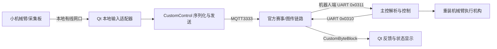

# RMUL 3V3 界面与开发方案讨论稿

2026-11-11；用户确认以2027 RMUL 3V3为主。以下分开记录官方事实与工程建议，尚未确定最终布局或开始实现。

## 规则给界面带来的变化

| 要素 | 2027 RMUL 3V3 事实 | 界面/状态模型影响 |
| --- | --- | --- |
| 阵容 | 重装1、步兵3、哨兵7，各1台；哨兵操作手0人（规则印刷p16/PDF17） | 登录和阵容筛选只显示对应角色；红蓝ID分别1/3/7与101/103/107。哨兵可列入队伍状态，不能由“有终端名额”推导为可以人工操控 |
| 时长与判胜 | 5分钟；双方初始控制度600；控制区每处使对方每秒−1，战亡使己方−10（p16、37/PDF17、38） | 顶部主指标改为双方控制度与5分钟倒计时；控制度0有真实含义，未收数据不显示假600 |
| 超时判胜 | 控制度→全队攻击伤害→总剩余血量→平局（p38/PDF39） | 结算按GameStatus的结果/原因展示；伤害和全队血量作为辅助信息，不照搬基地摧毁动画 |
| 地图 | 12m×8m；补给区、工作台、隧道、高地、红/中央/蓝三个控制区（p22–23/PDF23–24） | 重做赛场资源、热点和投影；旧28×15坐标参数不能只在图片处改。官方定位原点/轴向/单位仍须抓包或图纸验证 |
| 经济 | 初始200；每分钟按200/200/300/300补充；落后200/400控制度有补偿机制（p35/PDF36） | 显示官方下发经济，不在客户端自行加钱作为事实；初版只做所需兑换，不保留远程补血等不适用按钮 |
| 弹量兑换 | 17mm：10金币/10发；42mm：10金币/1发；重装/步兵激活补给区时兑换（p36/PDF37） | 角色、弹种、金币、补给区条件和官方返回状态共同约束按钮。发布成功不等于兑换成功 |
| 重装 | 工作台安装模块化42mm；成功安装并发射一发被裁判正确识别的42mm后提升性能（p37–38/PDF38–39） | 显示安装权限、安装事件和官方性能数据；机械臂连接/姿态属于队内数据。不要照搬工程科技核心兑换面板 |
| 步兵 | 赛前可选血量/功率、冷却/爆发体系，比赛开始并完成选择后不可更换（p18/PDF19） | 保留适用的性能预选与同步；比赛阶段锁定更换入口 |
| 哨兵 | 全自动；多机通信不允许；遥控器用于调试；初始750发且局内不能增加（p20–21/PDF21–22） | 展示可获状态；RMUL初版不开放遥控、半自动、地图驱动或人工姿态切换。通用协议存在SentryCtrlCommand不构成RMUL授权 |

## 推荐保留与替换范围

保留现有Qt技术栈、主视频显示、基本准星、网络连接与诊断、可用的血量/热量/允许发弹量/缓冲能量组件。沿用已具备的数据过期处理思路，并核实每个新字段的有效性与来源。

替换顶部基地/前哨信息为控制度；替换地图为RMUL场地；将英雄/工程分离的角色与菜单调整为重装，并重建其状态，不做全局字符串替换。关闭RMUL不适用的空中支援、飞镖、能量机关、科技核心四级装配、前哨复活等交互。

当前重点文件：

- `src/qml/TopInfoBar.qml`：顶部字段及420秒回退值。
- `src/qml/MiniMap.qml`：旧基地/前哨/能量机关标记，420秒时间计算，28×15坐标归一化。
- `src/core/MapCoordinateMapper.*`、`GameData.cpp`：也有地图尺寸/路径换算，必须统一来源。
- `src/qml/SettingsPanel.qml`、`src/ui/MainWindow.cpp`：登录角色、页面编排、角色事件和旧战斗提示。
- `src/qml/ExchangePanel*.qml`：依据RMUL可用指令重新筛选交互；不能把旧工程面板直接当模块化42mm安装控制器。

## 第一版界面建议

建议使用一套公共作战界面，按连接角色切换重装/步兵侧栏。重装优先级可在讨论中确定。

| 区域 | 建议内容 | 数据来源 |
| --- | --- | --- |
| 顶部 | 双方控制度、比分/局数、阶段和剩余时间、己方金币 | GameStatus、GlobalUnitStatus、GlobalLogisticsStatus |
| 中央 | 官方主图传、准星、必要告警 | UDP3334与现有视频链；队内瞄准量须另有明确来源 |
| 左侧/底部 | 当前车HP、热量/冷却、允许发弹量、模块故障、三车状态 | Static/Dynamic/Module、GlobalUnitStatus；未知值用“—”，过期显示状态 |
| 地图 | 12×8场地、自己可得位置、三个控制区位置、补给区/工作台 | 静态几何+合法定位；控制区实时归属需额外核验/回传 |
| 重装侧栏 | 42mm安装权限/状态、机械臂模式、关节/末端反馈、夹爪和异常 | Module #11、Event16、Static/Dynamic；机械臂反馈经队内0x0310子协议 |
| 步兵侧栏 | 性能选择、弹量兑换、适用的发射/底盘状态 | Performance消息、CommonCommand、队内状态 |
| 诊断 | 连接机器人ID、MQTT与视频分别在线/中断、本地控制器状态、数据更新时间 | 连接及各链路观测，避免一个“在线”灯代表所有链路 |

三个控制区的**位置**能先画；其归属/争夺状态在来源未接通时显示未知。不要用规则计时器或总控制度下降猜出精确归属和占领进度。

## 小机械臂、自定义终端与官方选手端的关系

这份Qt程序是自定义终端的软件主体，可以接收图传/赛事数据，也可以读取本地小机械臂输入并发布控制。它通过官方提供的网络接口对接官方链路；不需要把每个控制包先转交给官方选手端窗口。官方选手端仍涉及赛场连接与输入来源配置，不能把它当作本地MQTT broker就已完成的替代物。

建议讨论的链路如下，图表示目标架构，**尚未接通验证**：

本地“小机械臂→Qt”的网口协议与官方“Qt→机器人”的协议是两层，分别设计。需要明确角度/单位/坐标、版本、序号、使能/失联行为及反馈分流。原有28B六轴载荷可作为候选，不应在尚未确认自由度和控制模式时冻结。

网口拓扑也需要确认：机械臂采集板与官方网络是否共用接口、用USB转网口还是独立本地网段，均属于部署方案；不提前改电脑静态IP。制作规范要求有线连接，终端不使用无线收发装置（印刷p18/PDF19）。

## 推荐开发次序与验收证据

| 阶段 | 具体产出 | 完成依据 |
| --- | --- | --- |
| 1. 冻结基线 | 保存上游快照、官方版本、32Topic契约与歧义清单 | 来源和代码版本可追溯；本次调研已提供初稿 |
| 2. 2027协议适配 | 更新schema、生成物、收发路由；最小状态接收 | 字段presence/零值、地图方向、数组槽位等契约通过检查；模拟器同步 |
| 3. RMUL领域模型 | 阵容、控制度、300秒、角色/阶段功能、数据有效性 | 红蓝视角、控制度归零、缺失/过期状态等场景正确 |
| 4. RMUL作战界面 | 先公共信息+重装/步兵侧栏，再优化视觉 | 模拟器可重现界面和交互，隐藏非适用机制，地图转换可检验 |
| 5. 小机械臂闭环 | 本地输入、CustomControl、主控0x0311、0x0310反馈 | 逐段记录到包、字段、时延和失联行为；机器人端实际动作与反馈一致 |
| 6. 官方设备验收 | 实际赛事网络、图传和持续运行 | 2027设备抓包与回执/状态变化、1080p60性能、断线恢复记录；不以模拟器成功替代 |

阶段可以交错做数据回放和界面预览，但协议/状态含义先明确，再画依赖这些数据的最终布局。第一版重点是重装和步兵实际需要的信息，不把完整RMUC机制重新实现一遍。

## 下一轮讨论应确定什么

1. 第一版是否以**重装操作手界面**为主，再复用公共组件给步兵；还是两角色同时交付。
2. 小机械臂的实际硬件、自由度、当前网口输出格式；发送关节角、末端位姿还是模式/动作指令。
3. 三个控制区状态是否由己方机器人0x0101读取后回传；机器人端现有裁判串口能否提供。
4. 当前可以用于联调的官方2027赛事引擎、图传模块及固件版本。若暂时没有，先做模拟/回放验证，并单独保留实机验收项。
5. RMUL地图是否先按官方图纸制作简洁俯视图，还是已有队内底图/定位标定数据。

本轮已保存上述依据，下一轮可直接围绕第一版交付范围和重装控制链路讨论。
